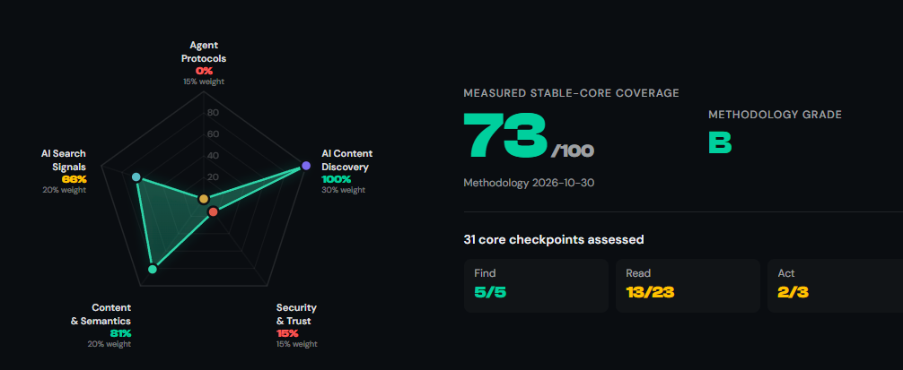

Un rastreador de IA lee tu HTML. Un **agente** hace algo más: abre tu web, navega, rellena formularios y pulsa botones en nombre de un usuario. Las dos cosas fallan por motivos distintos, y casi todo lo que he ido publicando sobre IA y SEO hablaba de la primera.

Esta guía junta lo que he ido viendo en las últimas semanas, ordenado por lo que haría primero. Parte de lo que cuento son estándares en borrador y estudios de un solo laboratorio, así que lo indico donde corresponde.

## 1. Que lo vean: contenido en el HTML inicial

Es lo más básico y lo que más veces falla. La mayoría de rastreadores de IA no ejecutan JavaScript, así que si tu contenido depende de él, no lo ven. Los pasos concretos (SSR, pruebas con `curl`, Search Console) los tienes en [CSR vs SSR: qué rastreadores ven tu JavaScript](https://emirodgar.com/csr-vs-ssr-rastreadores-javascript).

En un ecommerce no hace falta renderizarlo todo en servidor: contenido, enlaces y metadatos de home, categorías y productos en el HTML inicial, y JavaScript para filtros y personalización. También conviene revisar que `robots.txt` y el CDN no bloquean por error a los bots que sí te interesan, como explico en [segmentar el bloqueo de bots](https://emirodgar.com/segmentar-bloqueo-bots).

## 2. Que lo descubran: catálogo de recursos

Si tu sitio ofrece algo que un agente pueda usar (una API, un servidor MCP, un buscador), necesita encontrarlo. Lighthouse 13.5 ya incluye la auditoría **Agentic Resource Discovery**, que busca un catálogo en la directiva `Agentmap` de robots.txt, en una etiqueta `<link rel="ai-catalog">`, en una cabecera HTTP `Link` o en `/.well-known/ai-catalog.json`. Si no lo encuentra, aparece como "No aplicable". La especificación ARD está en borrador (v0.91), con `/.well-known/ard.json` como ruta propuesta.

Mi criterio: si no expones nada a agentes, no tienes nada que publicar. Si lo haces, merece la pena un catálogo y vigilar cómo evoluciona la especificación. Más detalle en [SEO en la era de la IA](https://emirodgar.com/seo-inteligencia-artificial).

## 3. Que lo puedan usar: la interfaz importa

Aquí está lo menos conocido. Merj probó agentes reales (ChatGPT Agent en Atlas, Computer Use de Claude, Comet de Perplexity y otros) y vio que los agentes **sí ejecutan JavaScript y aceptan cookies**, pero tropiezan con la interfaz. Lo que más les rompe:

- Superposiciones transparentes que absorben los clics.
- Diálogos nativos como `window.confirm()` y campos deshabilitados.
- Controles que no son controles reales, como un `
` en lugar de un `<button>`.
- Mensajes de error o éxito que desaparecen solos (los *toasts*).

El caso que más me ha llamado la atención es el de ARIA. Con etiquetas deliberadamente engañosas, ChatGPT Agent pulsó "Cancelar" primero en 25 de 25 ejecuciones cuando la tarea era guardar. **Una etiqueta ARIA incorrecta puede ser peor que no tener ninguna**, porque el agente se fía de ella antes que de lo que ve.

Un orden de trabajo razonable:

1. Cambia los `
` con comportamiento de botón por `<button>` reales.
2. Audita el ARIA por veracidad, no solo por presencia.
3. Elimina los overlays invisibles.
4. Haz persistentes los mensajes de error y de confirmación.
5. Añade pruebas de interacción al despliegue, igual que las [comprobaciones SEO automáticas antes de publicar](https://emirodgar.com/shopify-seo).

Todo esto es también accesibilidad, así que mejora tu web para personas.

## 4. Mide si funciona

Las herramientas de puntuación como [Is Agentic](https://is-agentic.com/) son un buen punto de partida, pero Merj es claro: miden prerrequisitos, no resultados.

{:class="img-responsive"}

Un 73/100 con nota B suena bien, pero fíjate en el desglose: descubrimiento de contenido al 100 %, protocolos de agentes al 0 % y seguridad y confianza al 15 %. La nota media esconde que hay zonas enteras sin cubrir. La única forma de saber si un agente completa tu compra, tu reserva o tu formulario es **probarlo en tus recorridos críticos**, en tus mercados y en tus idiomas. Su rendimiento baja fuera del inglés: en el estudio que citan, entre 9 y 18 puntos según el modelo.

Y una consecuencia para tu analítica: los agentes parecen usuarios, con reintentos y navegación mecánica. Si puedes identificarlos, exclúyelos de los embudos y de la medición de rendimiento real para no contaminar los datos.

### Clarity ya enseña qué hace un agente en tu web

El 4 de noviembre de 2026 Microsoft [presentó en Clarity](https://clarity.microsoft.com/blog/clarity-connects-agents-llms-people/) un panel de **Actividad de agentes** (Agent Activity). Muestra cómo evoluciona el tráfico de agentes con el tiempo, qué agentes te visitan y qué hacen al llegar: búsquedas, envíos de formularios, inicios de sesión, descargas, reservas y pagos. Por ahora solo detecta agentes de Google, OpenAI y Anthropic. Es gratuito y es la primera herramienta accesible que conozco que mide esto sin montar nada propio.

Incluye además **simulaciones**: pones a un agente a hacer una tarea importante en tu web y te dice si la completó, cuánto tardó, cuántas interacciones necesitó y dónde se atascó. Empiezan por escenarios de comercio y de viajes, así que si tu web es otra cosa, de momento te servirá menos.

Un dato para ponerlo en contexto, con la cautela de que lo publica el propio Microsoft: en un [análisis de Clarity](https://clarity.microsoft.com/blog/agentic-analytics-what-agents-do-on-websites) de 5,23 millones de sesiones de agentes en 230.511 proyectos (del 13 de agosto al 9 de septiembre de 2026), las sesiones semanales de agentes casi se duplicaron en tres semanas, hasta cerca de 2 millones. Son sitios que ya usan Clarity, no una muestra de toda la web, y no lo he probado en una web mía. Pero encaja con lo que dice Merj arriba: lo único que cuenta es ver si el agente consigue terminar la tarea, y ahora hay una forma gratuita de empezar a mirarlo.

Merj midió también que el éxito medio de los agentes en su banco de pruebas pasó de un 30 % a un 60 % entre noviembre de 2025 y marzo de 2026. Las pruebas de hoy envejecen rápido.

## 5. WebMCP, solo si lo justifica

[WebMCP](https://emirodgar.com/que-es-mcp) es una propuesta para que la página exponga acciones estructuradas a los agentes sin que tengan que interpretar la interfaz. Sigue en fase experimental (prueba de origen en Chrome 149). En el benchmark de Merj fue entre 2,5 y 7,5 veces más rápido y mucho más barato por tarea, pero es un solo benchmark. Yo lo probaría en un flujo concreto antes de plantear nada más grande.

Si das ese paso, dos cautelas que también señala Merj: pon límites a las acciones destructivas y trata el contenido generado por usuarios (reseñas, comentarios) como una posible vía de inyección de instrucciones para el agente.

## Y si eres tú quien decide qué agentes entran

Todo lo anterior parte de que quieres que los agentes usen tu web. Muchos comercios grandes no lo tienen tan claro. El 10 de noviembre de 2026 [The Verge contó](https://www.theverge.com/tech/1030838/ebay-ai-agents-meta-muse-agentic-shopping) que eBay parecía haber bloqueado a agentes como Muse, de Meta, durante el fin de semana. eBay no confirmó ningún cambio nuevo: dice que no es un bloqueo general, que permite la búsqueda y el descubrimiento con IA y cierta navegación asistida, y que bloquea el scraping no autorizado, incluida la recogida de datos para entrenar modelos. Ya en enero había cambiado sus condiciones de uso para prohibir los agentes de "compra por mí" que hacen pedidos sin revisión humana.

El resto del mapa, según el mismo artículo, es muy desigual: Amazon bloquea a los agentes externos por completo, Target los deja pasar unas veces y otras no, y Shopify ha abierto su catálogo para que los compradores configuren agentes que compren por ellos. Hay motivos prácticos detrás. En octubre The Verge comprobó que con Muse se podían retener productos de The RealReal añadiéndolos al carrito sin parar, y la tienda tuvo que ajustar su sistema contra bots.

Para no inflar la expectativa, un dato de uso real que dan las propias empresas: Uber dijo que en el tercer trimestre solo completó cuatro viajes pedidos a través de agentes de terceros, y unos 500 pedidos de Uber Eats la semana de Halloween. DoorDash habló de "varios cientos" de pedidos de agentes frente a 993 millones en total ese trimestre.

Mi lectura: permitir o bloquear agentes es una decisión por tipo de agente y por tipo de acción, igual que con los rastreadores, como cuento en [segmentar el bloqueo de bots](https://emirodgar.com/segmentar-bloqueo-bots). Con tan poco volumen, yo primero mediría quién entra de verdad (el panel de Clarity de arriba sirve para eso) y después decidiría, en lugar de abrir o cerrar a ciegas.

## Por dónde empezaría

Primero que el contenido esté en el HTML inicial. Después, los controles reales y el ARIA veraz, que ayudan a todos. Después, medir con tareas reales. El catálogo ARD y WebMCP dependen de si tu sitio ofrece algo que un agente pueda usar, y todavía es pronto para apostar fuerte por ellos.

Tu interfaz ya es una interfaz de software para los agentes, aunque nadie la haya documentado ni testeado. Mejor probarla tú antes que enterarte por una venta perdida.

*Esta guía forma parte de [El SEO en la era de la IA - Cómo optimizar para los modelos de lenguaje](https://emirodgar.com/seo-inteligencia-artificial).*

## Más sobre este tema

- [GEO para ecommerce, cómo aparecer en las compras con IA](https://emirodgar.com/geo-ecommerce)
- [Qué es el Protocolo de Contexto de Modelo (MCP)](https://emirodgar.com/que-es-mcp)
- [Cómo montar tu primer agente de IA para SEO con Claude (paso a paso)](https://emirodgar.com/agente-seo-claude)
- [Agentes IA](https://emirodgar.com/agentes-ia)
- [Google AP2 el protocolo que cambiará las compras online con IA](https://emirodgar.com/google-ap2-protocolo-compras-online-ia)
- [Cómo cambia el proceso de compra en la era de la inteligencia artificial](https://emirodgar.com/como-cambia-el-proceso-de-compra-en-la-era-de-la-inteligencia-artificial)
- [Riesgos de conectar tus herramientas a ChatGPT y otros agentes de IA](https://emirodgar.com/riesgos-conectar-herramientas-chatgpt)
