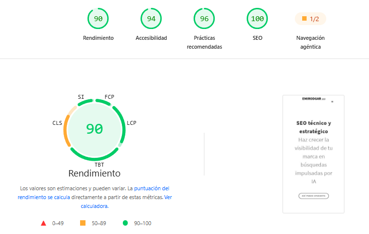

Desde el [cambio de algoritmo Mobile First Index](https://emirodgar.com/cambio-algoritmo-google), el tiempo de carga de una página web pasó a ser un [factor SEO](https://emirodgar.com/factores-seo) importante en cualquier estrategia de posicionamiento.

Si queremos disponer de una página cuyo tiempo de carga sea rápido y que nos permita mejorar posicionamiento, captación y conversión, estos son los puntos que deberíamos de trabajar.

## 1. Hosting

El [hosting afecta al SEO](https://emirodgar.com/hosting-seo) por lo que el servidor donde tengamos alojada nuestra página web es el primer aspecto que debemos trabajar. Un servidor profesional nos ofrecerá buenos tiempos de conexión por lo que antes de contratarlo conviene conocer qué valor de **Time to First Byte** (TTFB) ofrece.

>[Web server perfomance test](https://www.dotcom-tools.com/web-server-performance-test.aspx) nos ayudará a validar el tiempo de carga asociado a un hosting.
>
Si tarda mucho en servir nuestra página web, el resto de carga se verá afectado por lo que garantizar un rápido envío del primer byte es crucial para un correcto tiempo de carga.

Si nuestro servidor web no los permite, podemos instalar el [módulo PageSpeed de Google](https://developers.google.com/speed/pagespeed/module/?hl=es-419) que automáticamente configurará una serie de parámetros para optimizar el sitio web.

## 2. Elementos multimedia

Tanto imágenes como vídeos pueden provocar que nuestra página sea más lenta de lo necesario. A este respecto hay varias cosas que podemos hacer:

 1. [Carga selectiva (lazy load)](https://developers.google.com/web/fundamentals/performance/lazy-loading-guidance/images-and-video/?hl=es) en base a lo que se va mostrando en pantalla. En lugar de cargar todas las imágenes o vídeos de golpe, únicamente cargamos aquellas que entran en el campo de visión del usuario. A medida que hace scroll, vamos cargando las siguientes.
 2. Hacer uso de los nuevos formatos de imágenes como [webp](https://developers.google.com/speed/webp/) para mejorar la velocidad.
 3. [Comprimir las imágenes](https://web.dev/use-imagemin-to-compress-images) para que ocupen menos espacio. Podemos hacer uso de [ImageOptim](https://imageoptim.com/mac), [Squossh](https://squoosh.app/) o [Compressor.io](https://compressor.io/)
 4. Usar [imágenes con las dimensiones adecuadas](https://web.dev/serve-images-with-correct-dimensions). No tiene sentido poner una imagen grande si la vamos a mostrar en pequeño. Para páginas multidispositivo es importante aprender a utilizar las [imágenes adaptativas](https://web.dev/uses-responsive-images/).

> También es importante [optimizar las imágenes ](https://emirodgar.com/optimizacion-imagenes-seo) para que aporten valor a la estrategia SEO.

Por último, podemos hacer uso de una **[red de distribución de contenidos](https://emirodgar.com/cdn-seo)** (CDN) como Cloudflare que nos permitirá cachear y servir los ficheros estáticos de forma más rápida y eficiente, mejorando sustancialmente la carga de nuestro web

## 3. Comprimir los recursos

Hay ciertos recursos que creamos una vez y no volvemos a utilizar. Por ello se recomiendo comprimirlos al máximo (quitando espacios, comentarios o saltos de línea) para que ocupen el menor tamaño posible.

 - [Comprimir el código CSS](https://web.dev/unminified-css/). Recomiendo [CSSnano](https://github.com/ben-eb/cssnano) o [CSSO](https://github.com/css/csso). 
 - [Comprimir el código Javascript](https://web.dev/unminified-javascript/). Podemos usar [UglifyJS](https://github.com/mishoo/UglifyJS2).
 - [Comprimir el código HTML](http://minifycode.com/html-minifier/)

> Mucho ojo con [bloquear el acceso de los buscadores a los ficheros CSS y JS](https://emirodgar.com/bloquear-indexacion-js-css) puesto que podría afectar a nuestra estrategia SEO.

## 4. Eliminar aquello que no utilizamos

La forma más efectiva de aligerar nuestra web es eliminando aquello que no utilizamos. Es práctica habitual hacer un desarrollo y replicarlo a lo largo de todo el sitio web pero muchas veces, ciertas partes del mismo, son usadas de forma puntual; aún asi, las cargamos de forma transversal.

Por ejemplo, si en la home tenemos un banner y en el resto del sitio no, deberíamos tener un CSS/JS común a toda la página que no incluyera nada relacionado con el banner y, únicamente en la home, añadir ese código extra.

Podemos hacer uso de [Chrome Dev Tools](https://developers.google.com/web/updates/2017/04/devtools-release-notes#coverage) para identificar [el código CSS que no utilizamos en una página](https://web.dev/unused-css-rules/), de esa forma con retirarlo ajustaremos al máximo el tamaño de este fichero. Una aplicación online muy cómoda es [PurifyCSS](https://purifycss.online/).

También disponemos de extensiones para el navegador como [UnusedCSS](https://unused-css.com/) o [PurgeCSS](https://www.purgecss.com/) que nos facilitarán la tarea. 

Adicional a todo esto, existe un punto avanzado que también podemos trabajar. Se trata del [camino crítico para generar nuestra web](https://www.portent.com/blog/design-dev/the-critical-rendering-path-explained.htm). Si conseguimos identificar y separar la estructura crítica de lo demás -para que sea lo primero que cargue- conseguiremos una página realmente rápida.

## Herramientas para validar el tiempo de carga

Podemos hacer uso de aplicaciones como [PageSpeed Insights](https://pagespeed.web.dev/) (basada en [Google Lighthouse](https://emirodgar.com/automatizar-analisis-lighthouse)) o [GTMetrix](https://gtmetrix.com/) para conocer qué puntos debemos optimizar en nuestra web.

Este es el informe de PageSpeed Insights de esta misma web, analizada en móvil el 4 de noviembre de 2026. La puntuación de rendimiento es de 90 sobre 100 y el informe incluye también accesibilidad, prácticas recomendadas, SEO y la nueva categoría de navegación agéntica:

{:class="img-responsive"}

La puntuación de rendimiento sale de varias métricas: FCP (primer contenido visible), LCP (el elemento más grande), TBT (tiempo de bloqueo), CLS (estabilidad visual) y SI (Speed Index). Fíjate en el aro: el verde indica las métricas que van bien y el naranja, en este caso el CLS, la que todavía se puede mejorar.

PageSpeed también muestra cómo se va pintando la página mientras carga. Es muy útil para ver qué ve realmente el usuario en cada momento y detectar saltos de contenido:

{:class="img-responsive"}

### Ojo con comparar puntuaciones de antes y después

Desde finales de octubre de 2026, PageSpeed Insights usa [Lighthouse 13.6.0](https://www.searchenginejournal.com/pagespeed-insights-scores-lighthouse-update/595698/), que cambia cómo simula la carga. Según Barry Pollard, de Chrome, el FCP y el LCP simulados son ahora más precisos y, en general, dan puntuaciones más altas, sobre todo en webs con mucho JavaScript.

Esto significa que una página puede subir de nota sin que hayas tocado nada. Antes de presumir de una mejora:

- **Comprueba que los dos informes usan la misma versión de Lighthouse.** PageSpeed Insights la indica junto al dispositivo emulado.
- **Mira los datos de campo (CrUX)**, que son visitas reales de los últimos 28 días y no dependen de la simulación.
- **Si tienes gráficas de la nota de laboratorio**, espera un salto en la fecha del cambio.

El 90 de la captura anterior ya está medido con la versión nueva, así que no lo compares directamente con informes antiguos.

> Si quieres analizar todas las URLs de tu web de una vez, te explico cómo [automatizar el análisis de Lighthouse para múltiples páginas](https://emirodgar.com/automatizar-analisis-lighthouse).

<!--stackedit_data:
eyJoaXN0b3J5IjpbLTEzNzg5MTUyMTgsMTc0OTA4MzU0NCwtMT
kwMTkyMTEwMSwxNTc0OTg0NDk1LDE0MTgzODY1NDQsMTE3MDI4
MzExMiwtNTUwNzM0MDc4XX0=
-->